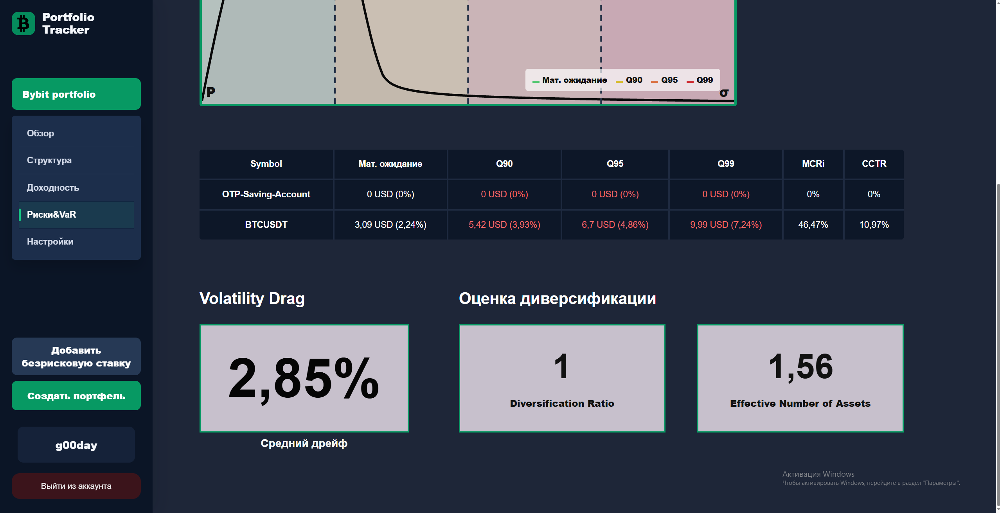

# Portfolio Tracker

Portfolio tracker for cryptocurrencies that implements risk, returns and diversification metrics for a certain portfolio: VaR, MCR, ENA etc. Datafetching via BybitAPI. Can be easily deployed on your local machine



## Main features

* **Real-time monitoring:** live pricing for crypto assets via Bybit API
* **Transaction tracking:** manual entry of buys, sells, transfers and portfolio snapshots over the time
* **Yield analysis:** calculating p&l and FOMO p&l(based on hypothetical buy of BTCUSDT), calculating Sharpe & Sortino ratios, correlation and covariance for portfolio PnL & FOMO pnl & risk-free rate for certain portfolio
* **Risk & diversification metrics:** general and specific Value-At-Risk based on parkinson volatility distribution - E(σ), Q90, Q95, Q99, Marginal&Component contribution to Risk, volatility drag, Diversification ratio&Effective number of assets
* **Custom risk-free rates:** ability to add versatile risk-free rates. For example bank deposits, treasuries, annualized strategy yield


## Tech Stack

* **Backend:** Go, chi
* **Frontend:** Vue, Vite
* **Database:** PostgreSQL
* **Market Data:** Bybit API v5
* **Deployment:** Docker, Docker Compose

## Getting Started

### Prerequisites
* Docker & Docker Compose installed on your machine.

### Configuration & Launch

1. Clone the repository:
   ```bash
   git clone https://github.com/g00day/PortfolioTracker.git
   cd PortfolioTracker
   ```

2. Create 2 `.env` files in the `backend` and `front` dirs based on each `.env.example`:  
   ```env
    # App settings
    APP_PORT=
    JWT_SECRET=
    PURPOSE_JWT_SECRET= # used in password resetting after verifying One-time-code


    #No reply email --- SMTP settings
    SMTP_HOST=
    SMTP_PORT=
    ...
   ```
   backend `.env.example`

   ```env
   # API address, basically http://localhost:8080
    VITE_API_URL=
   ```
    frontend `.env.example`

3. Build and run the backend containers in project root:
   ```bash
   docker compose up --build
   ```

4. Then install dependencies and run frontend application
    ```bash
    cd front/
    npm i
    npm run dev
    ```

5. Access the dashboard at `http://localhost:5173`

## Methodology

A brief overview of the financial models implemented in the engine:

* **Parkinson Volatility:** Uses High and Low prices ln(H_t / L_t) rather than just closing prices to capture intraday volatility more accurately. Perfectly fits cryptocurrencies due to containing no gaps.
* **Value at Risk (VaR):** Calculated across expected volatility E(σ) and upper quantiles Q_{90}, Q_{95}, Q_{99} to estimate potential downside risk.
* **Risk Attribution (MCR & CCR):** Decomposes total portfolio risk into Marginal and Component Contributions to identify which assets drive overall volatility.
* **FOMO PnL:** Benchmarks actual portfolio performance against a counterfactual DCA/lump-sum strategy in `BTCUSDT` over the exact same cash flow timestamps.
* **Effective Number of Assets (ENA):** Measures true portfolio diversification based on asset weights and correlation structure.
* **Diversification Ratio:** Quantifies the risk reduction gained from combining assets by comparing the weighted average of individual asset volatilities to the total portfolio volatility.
* **Sortino Ratio:** Evaluates risk-adjusted return over the custom risk-free rate, penalizing only downside volatility rather than total variance.
* **Covariance Matrix:** Captures pairwise return co-movements across portfolio assets to compute portfolio-level variance, diversification and risk contributions.

## Roadmap

- [ ] Redesign the frontend from scratch to improve usability, responsiveness, and fix existing layout bugs
- [ ] Translate UI components from Russian to English.
- [ ] Support for additional CEX APIs (Binance, OKX)
- [ ] Read-only exchange balance sync via API keys
- [ ] Export portfolio & risk analytics to CSV / PDF
- [ ] Monte-Karlo portfolio simulations based on correlation


