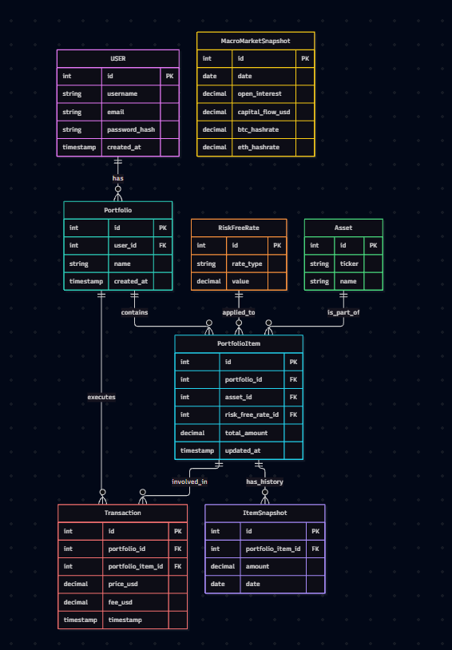

# Неделя 2 

## Разработка Backend

[Ссылка на код backend](https://github.com/g00day/PortfolioTracker/tree/backend/dev)

### Цель 

Разработать REST API для возможности создания инвестиционных портфелей, предоставления всех необходимых институциональных метрик оценки доходности и риска.

### Структура хранения

### Работа бэкенда, обработка данных и расчёт метрик

Посредством _транспортного уровня_ клиентское приложение получает программный интерфейс серверного приложения — REST API, декомпозиционно разделённые методы (эндпоинты) и средства взаимодействия с ними, предусмотренные протоколом HTTP.

_Слой адаптера_ регулирует процессы хранения, доступа и изменения сырых данных. Структурно этот слой разделён на два подслоя: `Репозитории и утилиты базы данных` и `Внешние API и их датафетчеры`.

Подслой `Репозитории и утилиты базы данных` хранит и предоставляет структуры для хранения и работы с необходимой информацией касательно пользовательских портфелей: активы, безрисковые ставки, распределение средств внутри портфеля.

В то время как подслой `Внешние API и их датафетчеры` предоставляет программный интерфейс для сбора биржевых данных: актуальных рыночных котировок, исторических данных цен активов и сопутствующих деривативов — производных контрактов.

Третий и последний слой — сервисный. Он отвечает за обработку сырых данных, поступающих со слоя адаптера: расчёт макроэкономических метрик, построение ковариационной матрицы активов, построение вероятностных распределений и др. Также внутри сервисного слоя происходит обработка данных, поступающих с транспортного слоя в соответствии с требованиями информационной системы.

### Результат 

В рамках второй недели разработки системы реализованы сервисный слой и слой адаптера серверного приложения.
